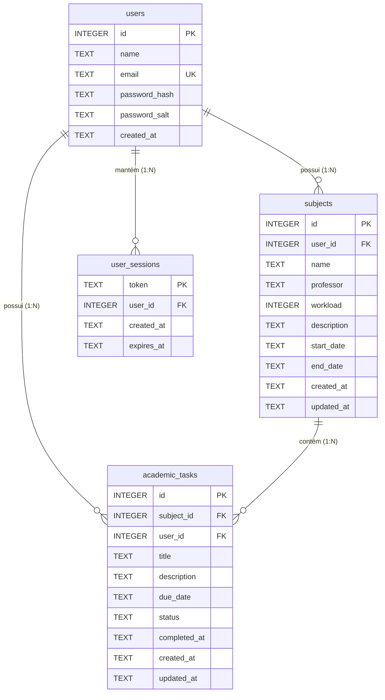

# Dicionário de Dados — EduTrack AI

Este documento detalha o modelo de dados relacional implementado no SQLite (`edutrack.db`) para o projeto **EduTrack AI — Assistente Educacional Personalizado**, em conformidade com as regras de integridade referencial (`PRAGMA foreign_keys = ON`).

---

## 1. Diagrama de Relacionamento (ER)

---

## 2. Tabelas do Sistema

### 2.1. Tabela: `users`
Armazena as contas dos estudantes cadastrados na plataforma.

| Campo | Tipo | Chave Primária (PK) | Chave Estrangeira (FK) | Obrigatório | Descrição |
| :--- | :--- | :---: | :---: | :---: | :--- |
| `id` | `INTEGER` | Sim | Não | Sim | Identificador único sequencial do usuário (Auto Increment). |
| `name` | `TEXT` | Não | Não | Sim | Nome completo do estudante. |
| `email` | `TEXT` | Não | Não | Sim | E-mail universitário exclusivo do estudante (Índice Único). |
| `password_hash` | `TEXT` | Não | Não | Sim | Hash criptográfico da senha (PBKDF2-HMAC-SHA256). |
| `password_salt` | `TEXT` | Não | Não | Sim | Salt pseudoaleatório exclusivo de 16 bytes em hexadecimal. |
| `created_at` | `TEXT` | Não | Não | Sim | Data e hora de criação da conta (Formato ISO / UTC). |

---

### 2.2. Tabela: `subjects`
Armazena as disciplinas acadêmicas cadastradas pelo estudante para seu semestre letivo.

| Campo | Tipo | Chave Primária (PK) | Chave Estrangeira (FK) | Obrigatório | Descrição |
| :--- | :--- | :---: | :---: | :---: | :--- |
| `id` | `INTEGER` | Sim | Não | Sim | Identificador único sequencial da disciplina (Auto Increment). |
| `user_id` | `INTEGER` | Não | Sim (`users.id`) | Sim | Identificador do usuário proprietário da disciplina (`ON DELETE CASCADE`). |
| `name` | `TEXT` | Não | Não | Sim | Nome da disciplina (ex: "Engenharia de Software"). |
| `professor` | `TEXT` | Não | Não | Sim | Nome do professor responsável pela disciplina. |
| `workload` | `INTEGER` | Não | Não | Sim | Carga horária total da disciplina em horas (utilizada para peso no progresso ponderado). Deve ser > 0. |
| `description` | `TEXT` | Não | Não | Não | Descrição da ementa ou tópicos da matéria. |
| `start_date` | `TEXT` | Não | Não | Sim | Data de início do período letivo da matéria (`YYYY-MM-DD`). |
| `end_date` | `TEXT` | Não | Não | Sim | Data de término prevista do período letivo (`YYYY-MM-DD`). |
| `created_at` | `TEXT` | Não | Não | Sim | Data e hora de cadastro do registro no sistema. |
| `updated_at` | `TEXT` | Não | Não | Sim | Data e hora da última atualização do registro. |

---

### 2.3. Tabela: `academic_tasks`
Armazena as tarefas, trabalhos, provas e revisões vinculadas a cada disciplina.

| Campo | Tipo | Chave Primária (PK) | Chave Estrangeira (FK) | Obrigatório | Descrição |
| :--- | :--- | :---: | :---: | :---: | :--- |
| `id` | `INTEGER` | Sim | Não | Sim | Identificador único sequencial da tarefa (Auto Increment). |
| `subject_id` | `INTEGER` | Não | Sim (`subjects.id`) | Sim | Chave estrangeira referenciando a disciplina vinculada (`ON DELETE CASCADE`). |
| `user_id` | `INTEGER` | Não | Sim (`users.id`) | Sim | Chave estrangeira referenciando o usuário proprietário (`ON DELETE CASCADE`). |
| `title` | `TEXT` | Não | Não | Sim | Título ou enunciado da tarefa (ex: "Trabalho 1 - CRUD"). |
| `description` | `TEXT` | Não | Não | Não | Detalhes, requisitos de entrega e instruções adicionais. |
| `due_date` | `TEXT` | Não | Não | Sim | Data prevista de entrega ou realização (`YYYY-MM-DD`). |
| `status` | `TEXT` | Não | Não | Sim | Situação da tarefa. Restrito a: `'pending'` ou `'completed'`. Padrão: `'pending'`. |
| `completed_at` | `TEXT` | Não | Não | Não | Data e hora em que a tarefa foi marcada como concluída (usado no cálculo de velocidade). |
| `created_at` | `TEXT` | Não | Não | Sim | Data e hora de criação da tarefa no sistema. |
| `updated_at` | `TEXT` | Não | Não | Sim | Data e hora da última alteração na tarefa. |

---

### 2.4. Tabela: `user_sessions`
Controla os tokens de sessão ativos para autenticação Bearer, garantindo o isolamento entre estudantes.

| Campo | Tipo | Chave Primária (PK) | Chave Estrangeira (FK) | Obrigatório | Descrição |
| :--- | :--- | :---: | :---: | :---: | :--- |
| `token` | `TEXT` | Sim | Não | Sim | Token criptográfico aleatório de 32 bytes em formato URL-safe. |
| `user_id` | `INTEGER` | Não | Sim (`users.id`) | Sim | Identificador do usuário autenticado (`ON DELETE CASCADE`). |
| `created_at` | `TEXT` | Não | Não | Sim | Data e hora de geração do token. |
| `expires_at` | `TEXT` | Não | Não | Sim | Data e hora de expiração da sessão (validade de 30 dias). |

---

## 3. Índices de Otimização

- `idx_subjects_user_id`: Otimiza filtros de disciplinas por usuário.
- `idx_tasks_subject_id`: Otimiza consultas de tarefas por disciplina e exclusões em cascata.
- `idx_tasks_user_id`: Garante isolamento estrito e velocidade nas consultas do usuário.
- `idx_tasks_status`: Acelera filtros por status ('pending' e 'completed').
- `idx_tasks_due_date`: Otimiza ordenações cronológicas e identificação de tarefas atrasadas.
- `idx_sessions_token`: Acelera a validação de autenticação em todas as requisições à API.
